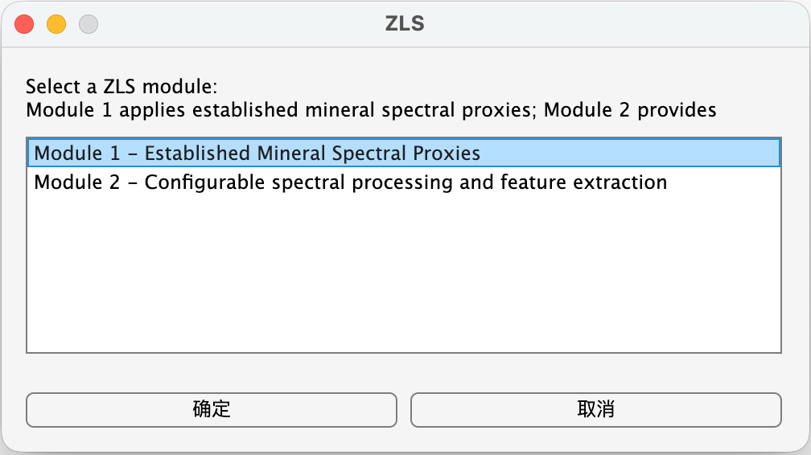
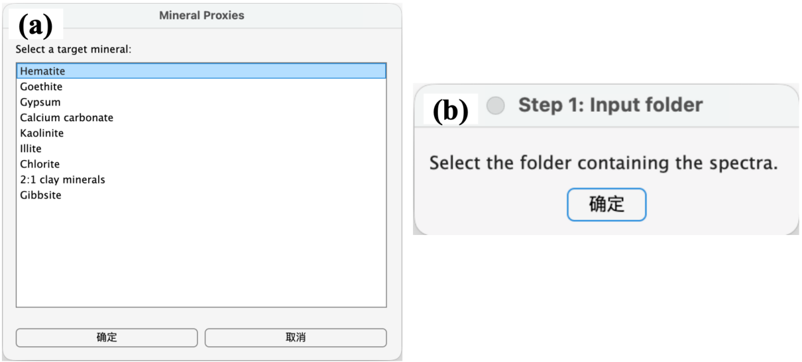
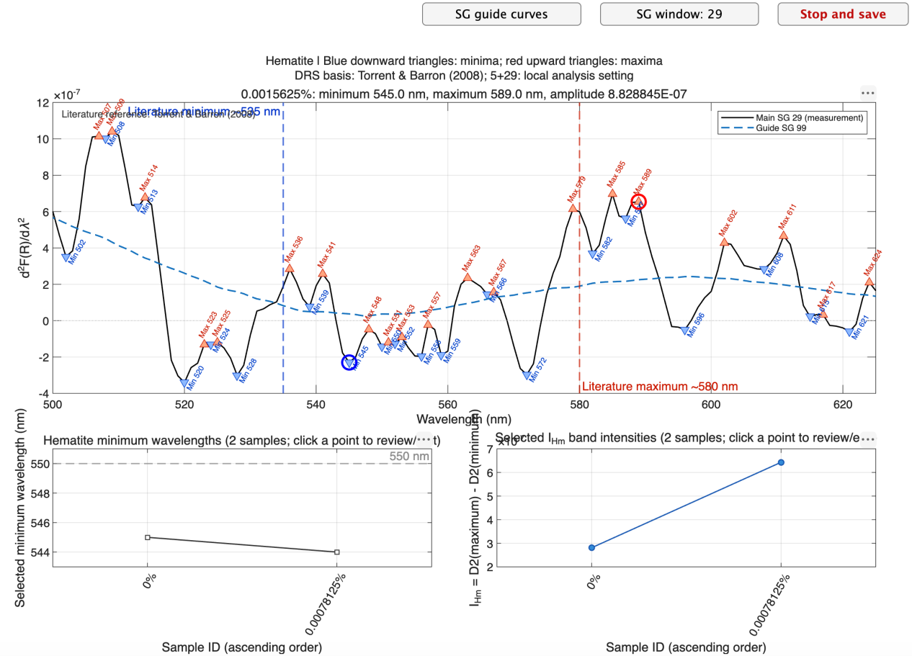
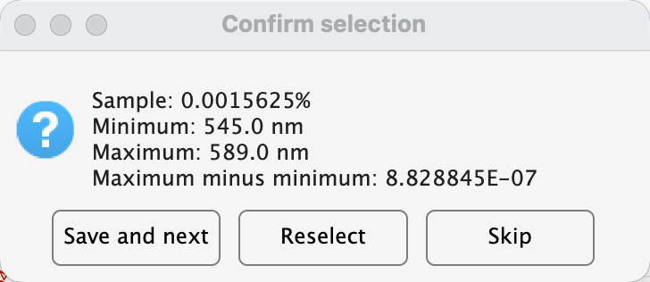
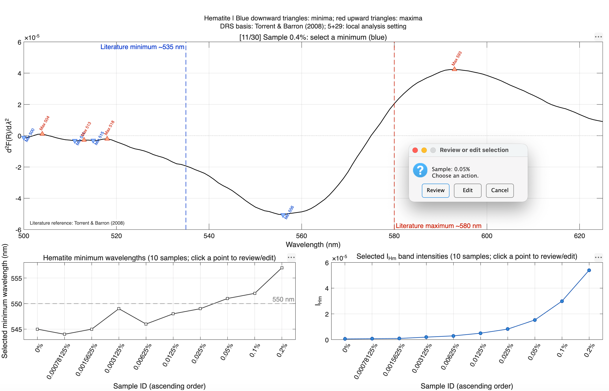
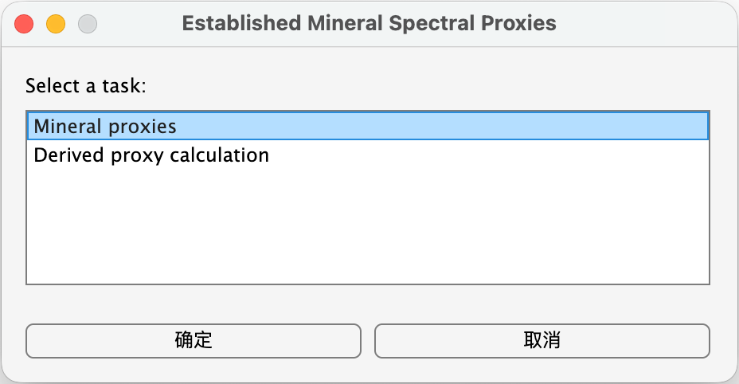
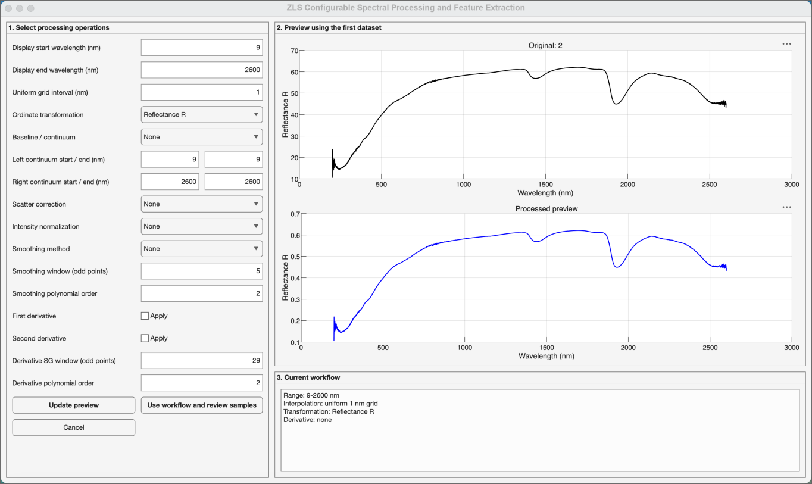

# ZLSpectra user guide

## 1. Start the application

Set the repository root as the MATLAB Current Folder and run `ZLSpectra`. Use the Established Mineral Spectral Proxies module for published mineral indices and derived calculations. Use Configurable Spectral Processing and Feature Extraction for parameter testing and feature exploration.

Screenshots illustrate the workflow; some show interface labels from an earlier program snapshot. Refer to the current source and the parameter descriptions below for the current settings.

## 2. Prepare and import a batch

Each spectrum uses a wavelength/reflectance column pair. Wavelengths are in nm. The included `data/*/spectra` files contain reflectance percentages and two header rows, followed by numeric observations. Select only the `spectra` subfolder of the required dataset. Original files, reference outputs and partial outputs are stored separately and must not be imported as raw spectra.

Select the target mineral, input folder and output workbook. Save the workbook outside the input folder. For the application examples, select Hematite or Calcium carbonate. All available samples in that folder are processed as a batch.

## 3. Review the spectrum and select the feature pair

The sample plot displays the processed spectrum. Blue downward triangles mark candidate minima; red upward triangles mark candidate maxima. Reference markers guide interpretation; they are not automatic assignments of mineral identity. Select the feature pair according to the target band and actual spectral structure. The application prompts for the required selection order; chlorite and the 2:1 group support a maximum before a minimum in wavelength order.

Current nominal goethite references are 425 nm (minimum) and 455 nm (maximum). The displayed range and any candidate-search intervals serve different purposes from these nominal reference lines. The hematite display covers 500–625 nm. See METHODS.md for the reference provenance and processing choices.

The confirmation dialog displays the selected wavelengths and amplitude. Save and continue, reselect, or skip the sample. A skipped sample has no confirmed feature pair; absence of a reliable feature should not be interpreted as a zero concentration.

## 4. Change the SG window or add guide curves

- **SG window:** change the second-stage window of the main curve. Enter an odd integer greater than the polynomial order and within the available spectrum length. Changing this window changes the measurement curve and may require reselection. Follow the confirmation dialog for the affected samples; previously saved results must be reviewed if mixing settings is not intended.
- **SG guide curves:** enter odd windows separated by spaces, for example `39 59 99`. These curves support comparison of broader spectral structure. Select measurement points on the main curve, not on a guide curve.

The calculation grid is 1 nm. A window of 29 points spans 28 nm between its first and last point; changing the window does not change the grid spacing. Larger windows can alter amplitude and local shape. Record the settings used for comparisons.

## 5. Review, revise and stop

The batch plot displays accepted mineral intensities. Click a sample point to reopen its spectrum and revise the selection. The hematite interface also displays characteristic absorption-band positions. Its 550 nm dashed line is a contextual comparison reference, not a universal climate threshold.

Use **Stop and save** to end the session. Confirmed records are saved to the selected workbook. When returning to a saved workbook, follow the application prompts to resume or review saved samples. Retain a copy of the original workbook before extensive revision.

## 6. Understand mineral outputs

The mineral worksheet includes Sample ID, Minimum (nm), Maximum (nm), and the index amplitude. The amplitude is D2(maximum) minus D2(minimum), not a mineral weight percentage. The selected wavelengths are in nm; with fractional reflectance and derivatives with respect to nm, second-derivative amplitude has units of nm^-2. Current workflows also record SG parameters where supported. The older reference workbooks supplied with the validation case do not have a full per-sample parameter sheet.

Do not equate the 2:1 clay-group index with separate concentrations of its member minerals or add it to individual illite/chlorite indices. Mineral concentration estimation requires an applicable calibration.

## 7. Derived proxy calculation

Choose Derived proxy calculation and import hematite and goethite band intensities. Select the matching identifier and intensity columns. The software matches sample identifiers, retains finite nonnegative pairs and calculates RelHm+Gt relative to the shared valid sample population. The sum of each mineral's intensities must be positive. Changing the included population can change the normalized values. RelHm+Gt is dimensionless and is not an absolute dust concentration or flux.

## 8. Configurable processing

Import a batch, choose a wavelength interval and sampling grid, and select operations and parameters. The program applies enabled operations in its defined order; it does not support arbitrary rearrangement. Inspect the first-sample preview before applying the settings to the batch. Compare original and processed spectra, select two-point features and export results.

The workbook contains `Processed_long`, `Selected_points`, and `Workflow`. These store processed spectra, feature coordinates/differences, and the processing sequence and settings, respectively. A new spectral feature requires validation before interpreting it as a mineral-content proxy.

## 9. Common problems

| Symptom | Check |
|---|---|
| MATLAB cannot find ZLSpectra | Set the Current Folder to the repository root or add it to the MATLAB path. |
| No valid spectra | Select the spectra subfolder, check numeric wavelength/reflectance columns and coverage. |
| No usable extrema | Check coverage, main SG window and feature visibility; inspect the raw spectrum. |
| SG window rejected | Use an odd integer greater than the polynomial order; reduce it if the spectrum is too short. |
| Legacy CSV header encoding problems | Use the supplied UTF-8 spectra CSV files rather than re-encoding originals in place. |
| Output cannot be written | Close the workbook in Excel and select a writable output location. |

See VALIDATION.md for the two complete application cases and the reference plotting script.
